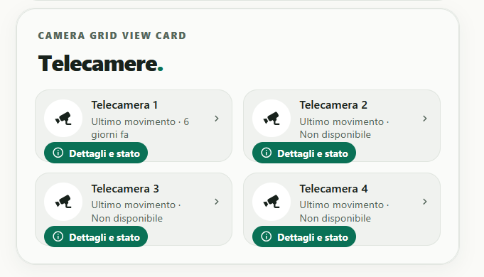

# Camera Grid View Card

**Camera Grid View Card** è una custom card per le dashboard Home Assistant che raccoglie più telecamere in un'unica griglia. Per ogni telecamera è possibile aprire un popup con l'ultima immagine rilevata, il movimento più recente e, quando disponibili, audio, stato della registrazione e batteria.

Il design è coerente con Security Panel Card e supporta i temi Auto, Light e Dark.

## Anteprima



## Funzionalità

- **Griglia flessibile:** 1, 2, 4 telecamere oppure disposizione personalizzata, senza un limite fisso al numero di telecamere configurabili.
- **Anteprime opzionali:** è possibile scegliere separatamente per ogni telecamera se mostrare l'ultima immagine nella dashboard. Le anteprime sono **nascoste per impostazione predefinita**.
- **Apertura immediata:** ogni riquadro mostra il badge verde **Dettagli e stato**, con icona circolare e tipografia coerenti con Security Panel Card.
- **Popup dedicato:** immagine più recente (`image.*`), data dell'ultimo movimento e pulsante verde per aprire i dettagli dell'immagine.
- **Audio facoltativo:** visualizzazione dello stato e, quando l'integrazione espone un'entità comandabile, pulsante per attivarlo o disattivarlo con conferma esplicita.
- **Registrazione facoltativa:** stato e comando di attivazione/disattivazione per ciascuna telecamera, con conferma esplicita quando è disponibile un'entità comandabile distinta dal sensore di stato. La card non crea registrazioni autonome.
- **Batteria facoltativa:** la voce è nascosta quando non è configurato o disponibile un valore valido.
- **Configurazione grafica:** editor Home Assistant con sezioni **Telecamere**, **Aspetto** e **Avanzate**, una telecamera alla volta, selettori delle entità e opzioni aggiuntive espandibili.
- **Temi:** Auto, Light e Dark con stile visivo Edera.

La card visualizza **snapshot**, non avvia automaticamente streaming live e non registra video o audio.

## Configurazione visuale

Dall'editor della scheda:

1. In **Telecamere**, aggiungere i dispositivi e selezionare per ciascuno l'entità `image.*` dell'ultima immagine.
2. Assegnare un nome visualizzato e scegliere se mostrare l'anteprima nella dashboard.
3. Aprire **Altre opzioni** per collegare movimento, data evento, stato audio, controllo audio, stato registrazione, controllo registrazione e batteria, quando disponibili.
4. In **Aspetto**, scegliere titolo, tema e disposizione della griglia.
5. In **Avanzate**, abilitare i comandi reali solo se necessari e dopo aver verificato le entità configurate.

Le entità facoltative possono essere lasciate vuote. I controlli audio e registrazione richiedono ciascuno un'entità `switch.*` o `input_boolean.*` realmente collegata alla rispettiva funzione del dispositivo. I sensori `binary_sensor.*` e `sensor.*` forniscono soltanto lo stato e non possono comandare dispositivi. Il pulsante di controllo compare solo se abilitato sia globalmente sia nella singola telecamera e quando lo stato dell'entità di comando è noto. Ogni azione chiede conferma prima di inviare il comando a Home Assistant.

## Installazione tramite HACS

L'installazione può essere eseguita aggiungendo il repository come **archivio personalizzato** HACS:

[](https://my.home-assistant.io/redirect/hacs_repository/?owner=luigi-regolo&repository=camera-grid-view-card&category=plugin)

Il pulsante apre la procedura di installazione tramite My Home Assistant. L'aggiunta del repository e l'installazione richiedono la conferma dell'utente.

1. In Home Assistant aprire **HACS → ⋮ → Archivi personalizzati**.
2. Inserire `https://github.com/luigi-regolo/camera-grid-view-card`.
3. Selezionare la categoria **Dashboard**, aggiungere l'archivio e installare **Camera Grid View Card**.
4. Ricaricare la pagina di Home Assistant e aggiungere la scheda dalla dashboard.

Se la risorsa non viene registrata automaticamente, verificare che sia presente `/hacsfiles/camera-grid-view-card/camera-grid-view-card.js` come **Modulo JavaScript** nelle risorse della dashboard.

## Configurazione YAML facoltativa

La card può essere configurata dall'interfaccia grafica senza scrivere YAML. Il seguente esempio mostra i campi principali con identificativi **fittizi**:

```yaml
type: custom:camera-grid-view-card
title: Telecamere
theme_mode: auto
layout: '4'
controls_enabled: false
cameras:
  - name: Ingresso
    image_entity: image.ingresso_demo
    motion_entity: binary_sensor.movimento_ingresso_demo
    show_preview: false
  - name: Giardino
    image_entity: image.giardino_demo
    show_preview: true
```

## Sicurezza e privacy

- Senza anteprima, la scheda non crea l'elemento immagine nella griglia e non richiede lo snapshot finché non viene aperto il popup.
- La scelta di nascondere le immagini è una **protezione visiva**, non una limitazione dei permessi Home Assistant. Gli utenti già autorizzati possono accedere alle entità anche da altre interfacce.
- Le immagini sono caricate da URL relativi alla stessa origine di Home Assistant; la card non incorpora servizi di analisi, telemetria o librerie JavaScript remote.
- I comandi audio e registrazione sono **disattivati di default**. Occorre abilitarli a livello globale e per ogni telecamera interessata. Sono soggetti alle autorizzazioni Home Assistant e chiedono conferma.
- Le azioni di registrazione si applicano esclusivamente alle entità configurate: non vengono chiamati servizi di registrazione video generici né vengono conservati filmati dalla card.
- L'ultimo movimento è ricavato dal sensore e da eventuali timestamp disponibili; se necessario la card consulta la cronologia Recorder all'apertura del popup. Quando non ci sono dati affidabili mostra **Non disponibile**.
- Dispositivi e integrazioni possono usare servizi cloud propri, indipendenti dalla card.

## Segnalazioni

Eventuali problemi possono essere segnalati nella sezione [Issues del repository](https://github.com/luigi-regolo/camera-grid-view-card/issues). Prima di condividere log, immagini o configurazioni, rimuovere credenziali, token, indirizzi e altri dati personali.

## Licenza

GNU GPL-3.0-only — consultare [LICENSE](LICENSE).
