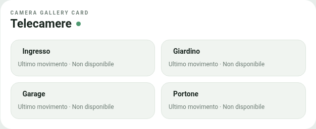

# Camera Gallery Card

**Galleria di telecamere per Home Assistant**, con design Edera ispirato a Security Panel Card, anteprime opzionali per privacy e dettagli in popup per ciascuna telecamera.

> Versione di sviluppo **0.1** (package `0.1.0`), **non ancora validata su un'istanza Home Assistant reale**. Prima della release pubblica verificare editor, immagini e controlli audio in Home Assistant.

## Anteprima



Anteprima dimostrativa della struttura Light con telecamere fittizie e anteprime disattivate. Il rendering definitivo va verificato in Home Assistant; non sono incluse immagini di installazioni personali.

## Funzionalità

- Configurazione di **1, 2, 4 o N telecamere**, senza limite fisso al numero di entità in elenco.
- Layout automatico o personalizzato, adattabile a smartphone e desktop.
- **Anteprima snapshot disattivata per impostazione predefinita** e configurabile per ogni telecamera.
- Popup per ogni telecamera ispirato al dettaglio **Spioncino** di Security Panel Card: ultima immagine, data e ora dell'ultimo movimento, audio e batteria opzionale.
- Immagini locali tramite le entità standard **`image.*`** e relativa risorsa `entity_picture` di Home Assistant. Non viene avviato un flusso video.
- Movimento tramite `binary_sensor.*` ed eventualmente `sensor.*` o `input_datetime.*` con data evento. In mancanza di un timestamp affidabile, la card consulta la cronologia Recorder fino a sette giorni **solo quando si apre il popup**.
- Controllo audio opzionale tramite `switch.*` o `input_boolean.*` esplicitamente configurati e abilitati. Il controllo è disponibile solo se il dispositivo/integratore espone una vera entità comandabile.
- Stato audio opzionale da `switch.*`, `input_boolean.*`, `binary_sensor.*` o `sensor.*` (interpreta solo gli stati standard `on`/`off`).
- Batteria opzionale tramite `sensor.*`; la riga non compare quando manca un valore valido.
- Temi **Auto**, **Light** e **Dark** nello stile Edera.
- Editor visuale Home Assistant con selettori di entità (e input ID in fallback), aggiunta, rimozione e riordino delle telecamere.

## Privacy e sicurezza

Quando l'anteprima è disattivata, **non viene creato un elemento immagine nella dashboard per quella telecamera**: lo snapshot non viene richiesto dalla card fino all'apertura del popup. La protezione è visiva e non modifica i permessi Home Assistant: gli utenti autorizzati possono comunque accedere all'entità e alle sue immagini da altre interfacce.

- Nessuna telemetria, analisi, pubblicità o libreria JavaScript remota.
- Nessuna credenziale o token raccolto dalla card.
- Solo URL di immagini relativi alla stessa origine Home Assistant, senza caricamenti diretti da domini esterni.
- **Comandi reali disabilitati di default**. Per controllare l'audio, abilitarli nell'editor (Avanzate) e abilitare il controllo per ciascuna telecamera.
- La card non presume che un comando abbia avuto effetto: mostra lo stato restituito dalle entità Home Assistant.
- La cronologia Recorder è facoltativa e dipende dalla sua configurazione e dalla conservazione degli eventi.
- La disponibilità effettiva delle immagini e dell'audio dipende dai dispositivi e dalle integrazioni usate.

## Installazione HACS (repository personalizzato)

1. Aprire HACS, menu **⋮ → Archivi personalizzati**.
2. Inserire l'indirizzo del repository pubblicato e scegliere la categoria **Dashboard**.
3. Installare la card e ricaricare Home Assistant.
4. Aprire la dashboard, aggiungere **Camera Gallery Card** e configurare le telecamere nell'editor visuale.

Prima della prima release, HACS può installare dalla branch predefinita (`main`). La `0.1` resta una versione di sviluppo, non è la versione stabile `1.0`.

Per l'installazione manuale di sviluppo, caricare `dist/camera-gallery-card.js` come risorsa di tipo **Modulo JavaScript**. Non usare questa procedura in produzione prima della validazione.

## Configurazione di esempio (valori dimostrativi)

```yaml
type: custom:camera-gallery-card
title: Telecamere
theme_mode: auto
layout: '4'
controls_enabled: false
cameras:
  - name: Ingresso
    image_entity: image.ingresso_demo
    motion_entity: binary_sensor.movimento_ingresso_demo
    show_preview: false
    audio_control_enabled: false
  - name: Giardino
    image_entity: image.giardino_demo
    show_preview: true
```

Gli identificativi sono fittizi. L'editor grafico rende facoltativa la configurazione YAML.

## Verifiche

Eseguire con Node.js 20 o successivo:

```sh
npm run check
npm test
```

Sono inclusi test per defaults privacy, numero di telecamere, sanificazione degli ID, URL immagini, lettura eventi Recorder e autorizzazione dei comandi audio.

## Licenza

GNU GPL-3.0-only. Vedere [LICENSE](LICENSE).
