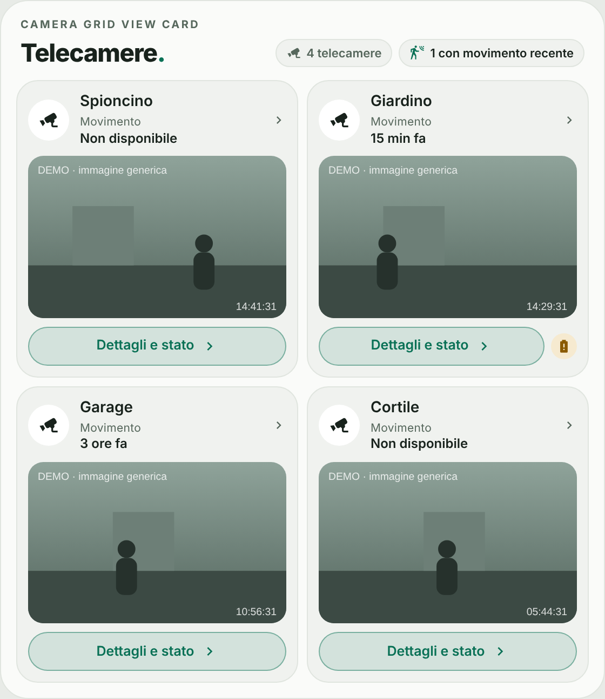
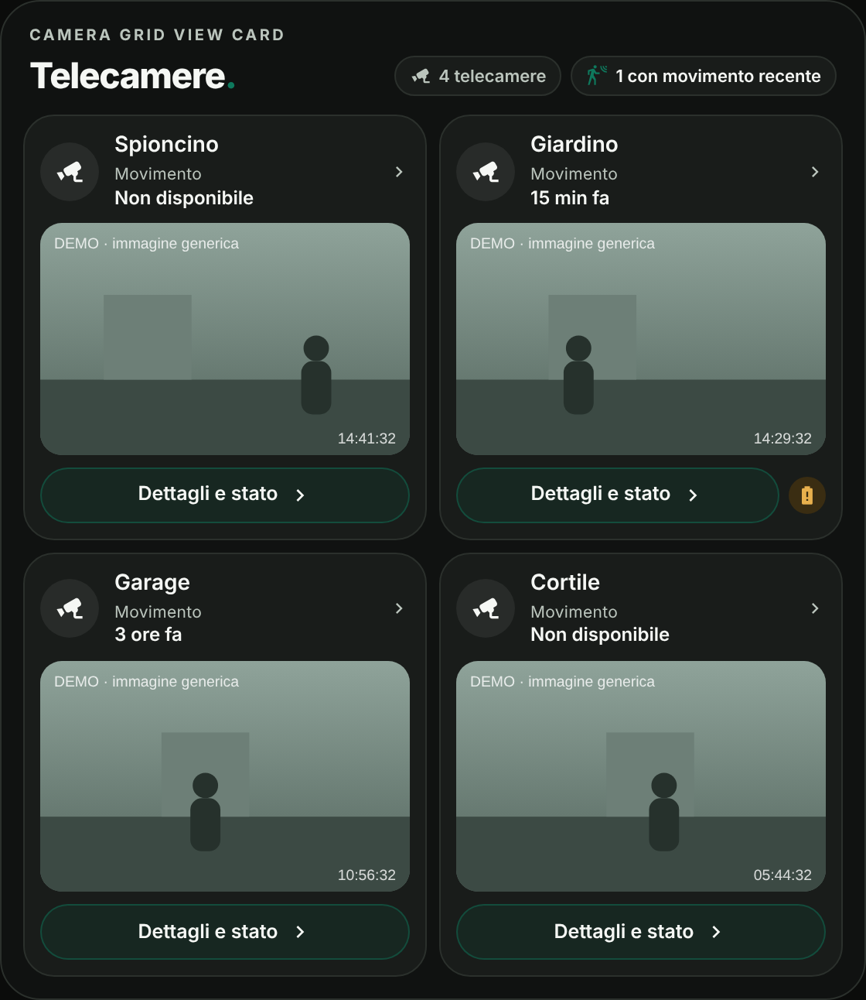
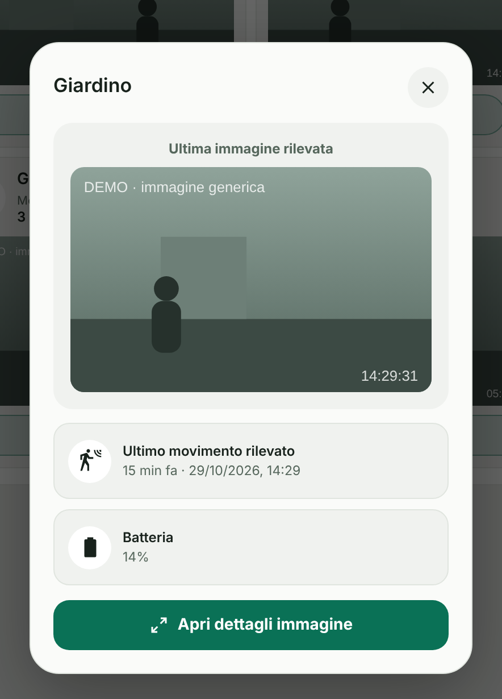

# Camera Grid View Card

[](https://www.tiktok.com/@luigi.regolo)
[](https://github.com/luigi-regolo/camera-grid-view-card/releases/latest)
[](LICENSE)
[](https://my.home-assistant.io/redirect/hacs_repository/?owner=luigi-regolo&repository=camera-grid-view-card&category=plugin)
[](https://github.com/luigi-regolo/camera-grid-view-card/stargazers)

## Overview

**Camera Grid View Card** is a custom camera card for Home Assistant dashboards, designed with a minimalist interface inspired by the Edera Light and Dark visual styles.

It brings together multiple cameras in a compact, responsive grid with dedicated detail views, image snapshots, motion information, and optional audio, recording, and battery status.

The card uses entities and services already available in Home Assistant. It does not independently start live video streams or record video or audio.

## Preview







*Camera Grid View Card interface shown with demo data. Displayed information depends on the configured Home Assistant entities and integrations.*

## Features

- **Flexible camera grid:** Layouts for one, two, or four cameras, plus configurable custom columns, without a fixed limit on the number of configured cameras.
- **Optional image previews:** Show the latest camera image directly in the dashboard. Previews are disabled by default.
- **Camera details:** Each tile includes a **Dettagli e stato** button and opens a dedicated details popup.
- **Optional automatic popup:** Opens the latest detected image when a configured `image.*` entity updates, then closes automatically after a configurable time. Works only while the dashboard is open and visible. Disabled by default.
- **Image snapshots:** Display the latest available image from a compatible `image.*` entity.
- **Motion information:** Show the most recent available movement using configured sensors, event timestamps, and Home Assistant Recorder history when available.
- **Optional audio status:** Display the audio state supplied by a compatible entity.
- **Optional audio controls:** Enable or disable audio using a supported control entity, with explicit confirmation.
- **Optional recording status:** Display the current recording state when provided by the camera integration.
- **Optional recording controls:** Control supported recording functions using a compatible entity, with explicit confirmation.
- **Optional battery information:** Show battery percentage when a valid value is available.
- **Visual configuration:** Configure individual cameras and settings through the Home Assistant dashboard editor.
- **Edera appearance:** Automatic, Light, and Dark themes with Home Assistant Material Design Icons.
- **Responsive layout:** A responsive interface for desktop, smartphone, and tablet dashboards.

Available information and controls depend on the capabilities of the configured devices and integrations.

The card does not provide its own video recording or storage service.

## Installation

### HACS (Recommended)

Camera Grid View Card is available in the default HACS catalog.

1. Open **HACS** in Home Assistant.
2. Search for **Camera Grid View Card**.
3. Select the card and click **Download**.
4. Reload the Home Assistant dashboard if necessary.
5. Add the card using the visual editor.

### Alternative: Custom repository

If you prefer to add the repository manually, you can use the HACS custom repository option.

[](https://my.home-assistant.io/redirect/hacs_repository/?owner=luigi-regolo&repository=camera-grid-view-card&category=plugin)

1. Open **HACS** in Home Assistant.
2. Open the HACS menu and select **Custom repositories**.
3. Enter the repository URL:

   `https://github.com/luigi-regolo/camera-grid-view-card`

4. Select **Dashboard** as the repository type and add it.
5. Find **Camera Grid View Card** in HACS and download it.
6. Reload the Home Assistant dashboard if necessary.
7. Add the card using the visual editor.

The repository contains `hacs.json` and the distributable JavaScript module `dist/camera-grid-view-card.js`.

### Manual installation

1. Download `dist/camera-grid-view-card.js` from the GitHub repository.
2. Copy the file into the `www` directory of your Home Assistant configuration as `camera-grid-view-card.js`.
3. Open **Settings → Dashboards → Resources** in Home Assistant.
4. Add the following resource:

   `/local/camera-grid-view-card.js`

5. Select **JavaScript module** as the resource type.
6. Reload the dashboard and add the custom card.

If the `www` directory was just created, Home Assistant may need to be restarted before the resource becomes accessible.

## Configuration and Usage

### Visual editor

Open a dashboard in edit mode, add **Camera Grid View Card**, and configure the available settings.

The editor includes three main sections:

- **Cameras:** Add cameras, assign names, select image entities, configure previews, and set optional status and control entities.
- **Appearance:** Customize the title, header label, theme, and camera grid layout.
- **Advanced:** Enable optional device controls and the automatic popup when needed.

Optional entities can be left unconfigured.

Audio and recording controls require compatible `switch.*` or `input_boolean.*` entities connected to the corresponding device functions.

State-only sensors cannot directly control devices.

Controls must be enabled globally and individually for each relevant camera. Each supported action requires explicit confirmation before sending a command to Home Assistant.

### Automatic popup

When enabled, the card opens the camera popup when a camera's `image.*` entity gets a new image, and closes it after the configured number of seconds (default 15, range 5–60). It does not interrupt a popup you opened yourself, and clicking inside the popup keeps it open.

The setting is per card. To limit it to a specific device or person, enable it only on the card of that dashboard (for example a tablet dashboard). It does not work as a push notification and runs on every device that has the dashboard open.

### Example YAML configuration

Camera Grid View Card can be configured through the visual editor without writing YAML.

The following example uses fictional entity identifiers:

```yaml
type: custom:camera-grid-view-card
title: Telecamere
theme_mode: auto
layout: '4'
controls_enabled: false
cameras:
  - name: Ingresso
    image_entity: image.ingresso_demo
    motion_entity: binary_sensor.movimento_ingresso_demo
    show_preview: false
  - name: Giardino
    image_entity: image.giardino_demo
    show_preview: true
```

Replace the example entities with existing entities in your Home Assistant installation.

### Main configuration options

| Option | Description |
|---|---|
| `title` | Main card title. |
| `eyebrow` | Small header label above the title. |
| `theme_mode` | `auto`, `light`, or `dark`. |
| `layout` | `auto`, `1`, `2`, `4`, or `custom`. |
| `custom_columns` | Number of columns for a custom layout. |
| `controls_enabled` | Enables optional device controls globally. Disabled by default. |
| `auto_popup_enabled` | Enables the automatic popup globally. Disabled by default. |
| `auto_popup_seconds` | Seconds before the automatic popup closes. Default `15`, range `5`–`60`. |
| `cameras` | List of configured cameras. |

### Per-camera options

| Option | Description |
|---|---|
| `name` | Display name of the camera. |
| `image_entity` | Compatible image entity (`image.*`). |
| `show_preview` | Displays the camera image in the dashboard. Disabled by default. |
| `auto_popup` | Opens the automatic popup for this camera when its image updates. Disabled by default. |
| `motion_entity` | Optional motion sensor (`binary_sensor.*`). |
| `last_event_entity` | Optional event timestamp entity. |
| `battery_entity` | Optional battery sensor. |
| `audio_state_entity` | Optional audio status entity. |
| `audio_control_entity` | Optional audio control entity. |
| `audio_control_enabled` | Enables audio control for the selected camera. |
| `recording_state_entity` | Optional recording status entity. |
| `recording_control_entity` | Optional recording control entity. |
| `recording_control_enabled` | Enables recording control for the selected camera. |

## Compatibility and Requirements

Camera Grid View Card requires:

- Home Assistant with support for custom JavaScript dashboard modules.
- Compatible Home Assistant entities for the desired camera features.
- A configured `image.*` entity for displaying image snapshots.

Optional:

- Motion sensors and event timestamps.
- Audio and recording status entities.
- Compatible audio and recording control entities.
- Battery sensors.
- Home Assistant Recorder history for additional movement information.

No specific minimum Home Assistant version has been independently verified or declared for this repository.

The card uses native Home Assistant functionality and does not require additional JavaScript libraries, subscriptions, or dedicated paid cloud services.

Some camera devices and integrations may depend on their own external services.

## Privacy and Security

Camera Grid View Card uses entities, data, and permissions already available through Home Assistant.

Image previews are disabled by default. When a preview is disabled, the dashboard tile does not request or render the camera image.

Opening a camera details popup may display the latest image provided by the configured Home Assistant entity.

Camera images are loaded from Home Assistant-relative URLs rather than arbitrary external image URLs.

The card does not implement advertising, user tracking, telemetry, analytics, or external JavaScript services.

Audio and recording controls are disabled by default and require explicit configuration and confirmation.

The automatic popup is disabled by default. When enabled, camera images may appear on screen without user interaction, on every device displaying that dashboard. Enable it only on dashboards in trusted locations.

Hiding image previews is a visual privacy measure, not an access-control mechanism. Users with appropriate Home Assistant permissions may still access the underlying entities through other interfaces.

Recent movement information may depend on Home Assistant Recorder availability.

Connected camera devices and integrations may communicate with external services under their respective privacy policies and terms of use.

The card does not independently record or store camera footage.

## Releases

See [GitHub Releases](https://github.com/luigi-regolo/camera-grid-view-card/releases).

## Copyright & License

Copyright © 2026 luigi-regolo.

Original project created and maintained by **luigi-regolo**.

Licensed under the **GNU General Public License version 3 only (GPL-3.0-only)**.

See the [LICENSE](LICENSE) file for the complete license terms.

The software is provided without warranty to the extent permitted by applicable law.
